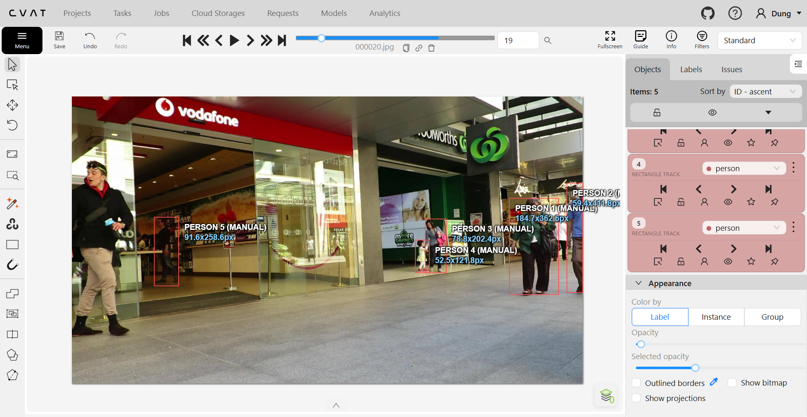
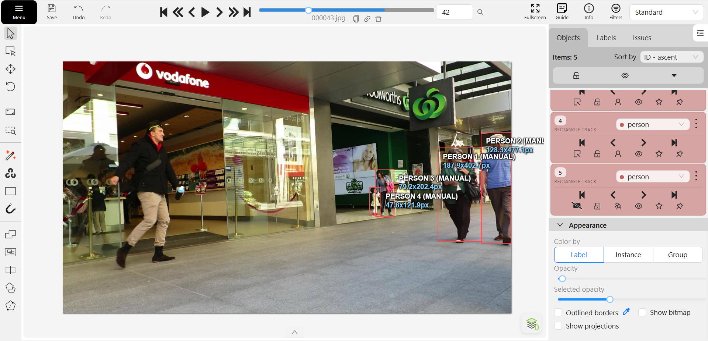
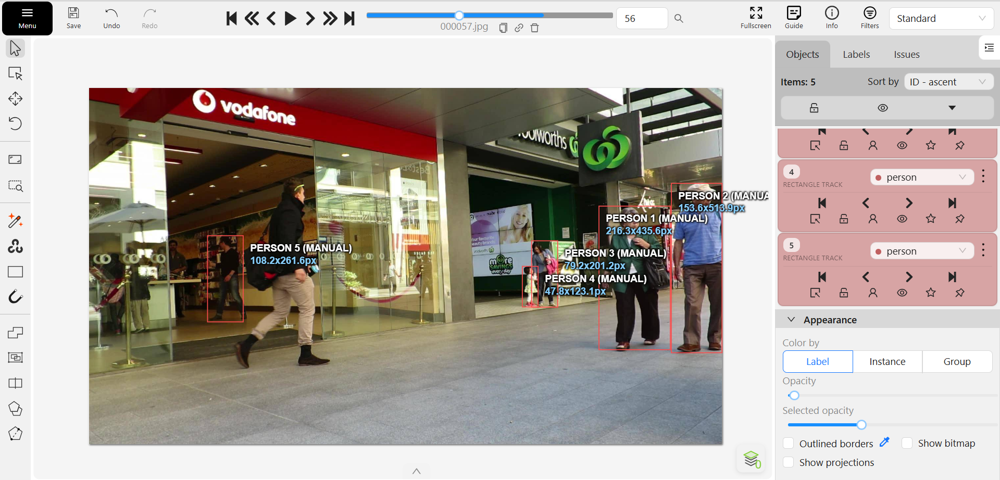

# Báo cáo cá nhân — LeNgocDung-2A202603103

Đổi tên file theo quy tắc `MSSV_HoTen.md`. Ví dụ: `20241234_NguyenVanAn.md`.

Đoạn video: MOT17-09, 150 frame (frame 1–150), nguồn MOTChallenge, giấy phép CC BY-NC-SA 3.0.

## 0. Thông tin học viên

* Họ tên: Lê Ngọc Dung
* MSSV: 2A202603103
* Mã đề (A/B/C): B
* Email: **bachdungbiu3010@gmail.com**
* Link repository: **https://github.com/bachdungbiu3010-art/K5-L2-DAY05-LeNgocDung-2A202603103-MOTTracking**
* Giờ bắt đầu: **17h**
* Giờ kết thúc: **19h**

## 1. Xem trước đoạn video (CP0)

Ghi **trước khi vẽ**, mỗi người một dòng.

|Mã|Frame xuất hiện|Frame cuối thấy được|Rẽ / dừng / đổi tốc độ ở frame|Bị che ở frame|Ghi chú|
|-|-|-|-|-|-|
|P1|000|149|**033-036**|27–55 (khuất hẳn 40–44)|Người tối màu bên trong cửa kính Vodafone (bên trái). **CVAT ID 5**|
|P2|000|149|Đi về phía camera, to dần cả đoạn|Không|Phụ nữ áo khoác xanh lá, túi đen, bên phải. **CVAT ID 1**|
|P3|000|149|Đi về phía camera, to dần; đi sát P2 từ khoảng frame 100|**0-17**|Đàn ông áo xanh dương, mũ trắng, ở mép phải ngay từ frame 0. **CVAT ID 2**|
|P4|000|119|**130-140**|110–119, khuất / ra khỏi khung từ 120|Bé gái áo trắng trước cửa Woolworths. **CVAT ID 4**|
|P5|000|108|**30-40**|99–108 (bị P2 che), khuất từ 109|Người lớn áo xám, túi hồng, cạnh P4. **CVAT ID 3**|

## 2. Keyframe và thời gian

Số keyframe lấy từ kết quả `src/check_submission.py`.

|Mã|Số keyframe|Keyframe ở frame|Số frame có mặt|Keyframe / 100 frame|Thời gian (phút)|Chỗ khó|
|-|-|-|-|-|-|-|
|P1 (ID 5)|21|0, 10, 20, 27, 28, 29, 30, 45, 50, 55, 60, 70, 80, 90, 100, 110, 120, 130, 139, 140, 149|145|14,5|15|Đứng sau kính, bị người áo đen che rồi khuất hẳn 40–44|
|P2 (ID 1)|16|0, 10, 19, 29, 39, 49, 59, 69, 79, 89, 99, 109, 119, 129, 139, 149|150|10,7|15|Lại gần camera, box to dần|
|P3 (ID 2)|16|0, 10, 20, 30, 40, 50, 60, 70, 80, 90, 100, 110, 120, 130, 140, 149|150|10,7|15|Bị mép phải ảnh cắt lúc đầu; đi sát P2 cuối đoạn|
|P4 (ID 4)|7|0, 10, 20, 30, 40, 80, 110|120|5,8|10|Box nhỏ; đi sát P5|
|P5 (ID 3)|9|0, 10, 20, 39, 49, 69, 79, 89, 99|109|8,3|10|Đi sát P4, bị P2 che từ frame 99|
|**Tổng**|**69**||**674**|**10,2**|||

Keyframe / 100 frame của cả bài = tổng keyframe ÷ tổng số frame có mặt × 100 = 69 ÷ 674 × 100 = **10,2**


Bạn đặt keyframe nhiều nhất ở người nào? Vì sao (người đó rẽ, dừng, lại gần camera hay bị che)?

Nhiều nhất ở **P1 (21 keyframe, 14,5 / 100 frame)**. P1 bị người áo đen đi ngang che từ frame 27, khuất hẳn ở frame 40–44 rồi hiện lại ở frame 45. Quanh đoạn che (27–30 và 45–55), vị trí phần thân nhìn thấy thay đổi nhanh, nên nội suy tuyến tính giữa hai keyframe cách xa sẽ đặt box lệch. Vì vậy phải đặt keyframe dày ở chỗ bắt đầu che và chỗ hiện lại. Ít nhất ở **P4 (7 keyframe)**: bé đi chậm, gần như thẳng đều, box nhỏ, ít đổi kích thước.

## 3. Đoạn bị che

Người bị che: `P1` (CVAT ID 5)

|Mốc|Frame|
|-|-:|
|Bắt đầu bị che một phần (bật `occluded`)|27|
|Mất hẳn (bật `outside`)|40|
|Hiện lại (tắt `outside`)|45|
|Thấy rõ trở lại (tắt `occluded`)|55|

* Thời gian khuất hẳn: 5 frame (40–44) = 0,17 giây.
* Người che: người đàn ông áo khoác đen đi ngang phía trước cửa kính Vodafone.
* Quyết định: **giữ cùng ID** (ID 5).
* Lý do (trả lời 3 câu: khuất bao lâu so với 60 frame, ngoại hình có khớp, chỗ hiện lại có đúng hướng và tốc độ):

  1. Khuất hẳn 5 frame (40–44), nhỏ hơn rất nhiều so với ngưỡng 60 frame của lớp.
  2. Ngoại hình khớp: cùng áo tối màu, cùng dáng và kích thước, vẫn ở bên trong cửa hàng Vodafone.
  3. Chỗ hiện lại ở frame 45 nằm ngay sau vị trí người áo đen vừa đi qua, đúng hướng và tốc độ cũ; không có người nào khác đi vào vị trí đó.

  → Theo guideline mục 3: khuất ≤ 60 frame và chắc chắn cùng người nên giữ cùng track, cùng ID 5. Tắt `outside` ở frame 45 và đặt keyframe mới.

Ảnh chụp màn hình:





## 4. Tự review ID (CP3)

Lượt 1 theo người (đi ngược từ frame 149 về 0 trên CVAT), lượt 2 theo cảnh (nhảy 10 frame). Ít nhất 3 dòng; không có lỗi thì ghi một dòng "đã kiểm hai lượt, không lỗi".

Loại lỗi dùng đúng một trong 7 mã: `id_switch`, `fragmentation`, `lost`, `merge`, `false_track`, `drift`, `flag`.

|Frame|Mã người|Loại lỗi|Mô tả một câu|Phát hiện ở lượt|Đã sửa?|
|-:|-|-|-|-|-|
|0–149|P1 (ID 5)|flag|Lúc đầu cờ occluded bật ở 121/150 frame, kể cả khi P1 chỉ đứng sau kính|Lượt 2|Đã sửa|
|40–44|P1 (ID 5)|flag|Bản xuất đầu tiên không có outside dù P1 bị người áo đen che kín|Lượt 2|Đã bật|
|55–60|P1 (ID 5)|flag|Frame 60 P1 đã thấy rõ nhưng box vẫn nét đứt|Lượt 2|Đã tắt occluded từ 55|

Tổng hợp số lỗi theo loại:

|`id_switch`|`fragmentation`|`lost`|`merge`|`false_track`|`drift`|`flag`|
|-:|-:|-:|-:|-:|-:|-:|
|||||||3|

Lỗi nào chỉ lượt 2 (theo cảnh) mới thấy, lượt 1 (theo người) không thấy? Vì sao?

Các lỗi này đều phát hiện ở lượt 2

Lượt 1 do đánh với tốc độ nhanh + chủ quan nên không kiểm soát kỹ

## 5. File xuất và kết quả tự kiểm (CP4)

|Kiểm tra|Kết quả|
|-|-|
|Tên file MOT 1.1|`src/exports/LeNgocDung_mot.zip`|
|Tên file CVAT for video 1.1|`src/exports/LeNgocDung_cvat_video.zip`|
|Số track ID khác nhau trong `gt/gt.txt` (phải là 5)|5|
|Frame `outside` không có dòng trong `gt.txt` (đúng / sai)|Đúng: ID 5 không có dòng ở frame_id 41–45 (CVAT 40–44)|
|Job đã completed trên CVAT máy cá nhân|**[TỰ ĐIỀN]** sau khi chuyển job sang completed|

Dán phần tóm tắt in ra từ `src/check_submission.py`:

```text
Số frame in theo CVAT (bắt đầu từ 0). Trong gt.txt, frame_id = frame CVAT + 1.

=== File MOT 1.1: LeNgocDung_mot.zip ===
  Số track ID: 5   |   Tổng số box: 674
  [OK]        Đúng 5 track ID.

  Track | Frame có mặt | Số frame | Đoạn vắng (outside)
      1 |   0–149      |      150 | -
      2 |   0–149      |      150 | -
      3 |   0–108      |      109 | -
      4 |   0–119      |      120 | -
      5 |   0–149      |      145 | 40–44


=== File CVAT for video 1.1: LeNgocDung_cvat_video.zip ===

  Track | Nhãn   | Frame thấy | Keyframe | KF/100 frame | Frame occluded | Lần bật outside
      0 | person |        150 |       16 |         10.7 |              0 |               0
              Track 0: keyframe ở frame [0, 10, 19, 29, 39, 49, 59, 69, 79, 89, 99, 109, 119, 129, 139, 149]
      1 | person |        150 |       16 |         10.7 |              0 |               0
              Track 1: keyframe ở frame [0, 10, 20, 30, 40, 50, 60, 70, 80, 90, 100, 110, 120, 130, 140, 149]
      2 | person |        109 |        9 |          8.3 |             10 |               1
              Track 2: keyframe ở frame [0, 10, 20, 39, 49, 69, 79, 89, 99]
      3 | person |        120 |        7 |          5.8 |             10 |               1
              Track 3: keyframe ở frame [0, 10, 20, 30, 40, 80, 110]
      4 | person |        145 |       21 |         14.5 |             23 |               1
              Track 4: keyframe ở frame [0, 10, 20, 27, 28, 29, 30, 45, 50, 55, 60, 70, 80, 90, 100, 110, 120, 130, 139, 140, 149]

  Tổng: 69 keyframe / 674 frame có mặt = 10.2 keyframe / 100 frame
  [OK]        Đọc được 5 track từ annotations.xml.

=== Tóm tắt ===
  Lỗi: 0   |   Cảnh báo: 0
  Đạt. Dán phần tóm tắt này vào báo cáo mục 5.
```

## 6. Ba câu kết


1. Nếu được gán lại, bạn sẽ đặt keyframe khác ở đâu? Vì sao?

   Tôi sẽ đặt keyframe ở chỗ người đó có 1 trong 3 dấu hiệu như đổi hướng, đổi tốc độ, dừng lại

   P4 không có keyframe nào ở đoạn frame 40–80, còn P2 và P3 đặt đều mỗi 10 frame

2. Có chỗ nào bạn không chắc "cùng ID hay ID mới"? Bạn đã quyết định và ghi chú thế nào?

   Tôi chưa phân vân chỗ này vì các vật thể để rất rõ và không khó nhận biết

3. Một lỗi ID trong job của bạn (nếu không còn sót, chọn lỗi đã sửa) có thể làm xe tự lái dự đoán sai chuyển động của người đó như thế nào? Lỗi đó ảnh hưởng MOTA hay IDF1 nhiều hơn?

   Ở 5 frame 40-44, P1 bị người áo đen che kín, không thấy chút nào.

   Nhưng vì không bật outside, file vẫn có 5 dòng box của ID 5. Box đó nằm đúng chỗ người áo đen đang đứng.


   Như vậy nhãn không làm xe “không nhận thức được người bị khuất”. Tăng chỉ số FP

## Bonus (nếu làm)

### B1 — Hai người đi sát

...

### B2 — So cách đặt keyframe

|Cách đặt|Số keyframe|Frame trôi nhất|Ghi chú|
|-|-:|-:|-|
|Đều mỗi 30 frame||||
|Theo chỗ đổi hướng||||

...

### B3 — So với tracker có sẵn

|Frame|Mã người|Tracker làm gì|Nhãn của bạn|Giải thích (đoán rồi sửa / ghép IoU / box score thấp / ngoại hình)|
|-:|-|-|-|-|
||||||
||||||

## 7. Tài liệu tham khảo và công cụ AI đã dùng

* Dữ liệu và ảnh chụp màn hình: MOT17, MOTChallenge (Milan et al., 2016), giấy phép CC BY-NC-SA 3.0.
* Tài liệu lớp: `RULES.md`, `docs/GUIDELINE.md`, `CHECKPOINTS.md`, `docs/MOT_FORMAT.md`.
* Công cụ AI: Claude (Anthropic), dùng để:

  * giải thích cách dùng CVAT (track mode, keyframe, `occluded` / `outside`) và quy ước của lớp;
  * soát ảnh chụp màn hình các box và chỉ ra chỗ cần kiểm lại;
  * chạy `src/check_submission.py`, đọc kết quả, điền số liệu mục 2, 3, 5 từ file xuất và sửa câu chữ báo cáo.
* Toàn bộ box và track ID do tôi tự gán tay trên CVAT.

